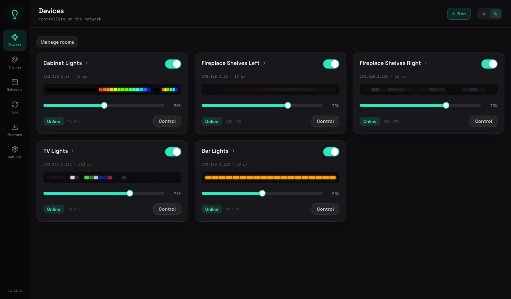
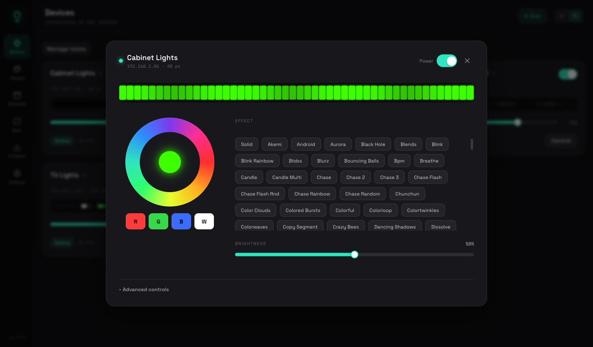
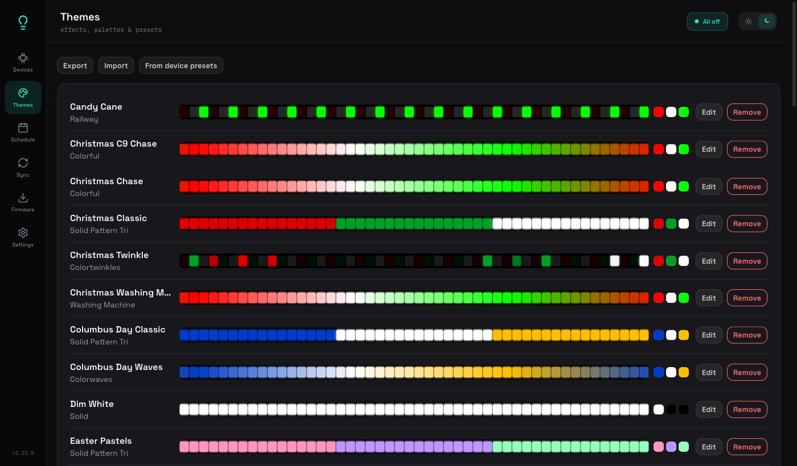
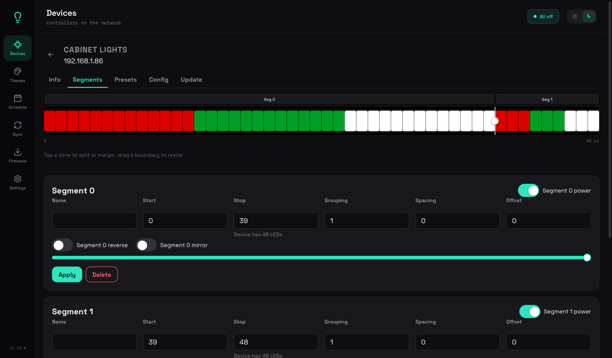
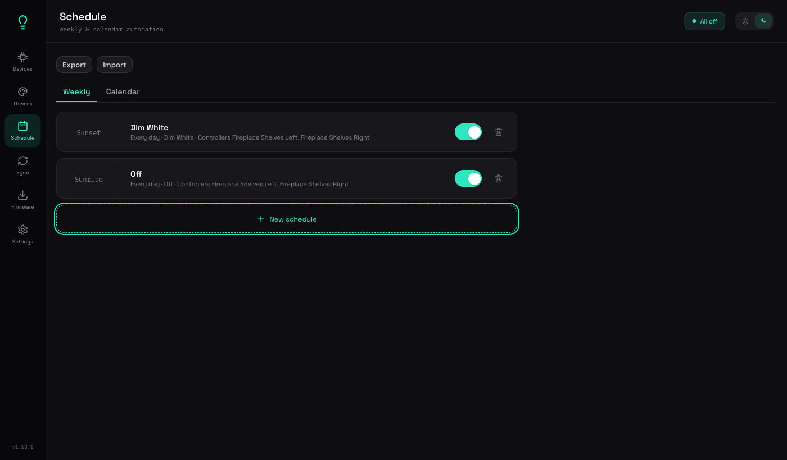
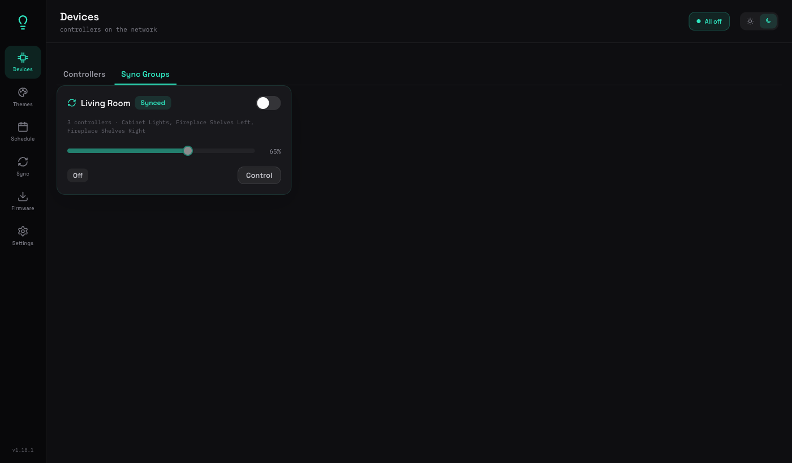

# uber-wled

A self-hosted, LAN-only control plane for every [WLED](https://kno.wled.ge/)
device on your network. One app replaces the per-device WLED web UIs and the
WLED phone app — multi-controller-first: select any mix of rooms, devices,
or segments and apply the complete WLED control surface (colors, effects,
palettes, presets, nightlight) to all of them at once. Fan-out writes carry
WLED's per-request no-notify flag (`udpn: { nn: true }`) so the app never
fights an existing UDP sync group.

Full design rationale lives in [docs/superpowers/specs/](docs/superpowers/specs/);
implementation plans live in [docs/superpowers/plans/](docs/superpowers/plans/).

## Screenshots

A dark-first interface (black + neon green `#22C55E`, Space Grotesk for UI + IBM Plex Mono for
metrics) with a one-click light theme — the theme, master brightness, and last
view persist across reloads. LED/effect previews sit on a dark housing in both
themes so the glow reads like real light.

| Devices — one card per controller | Control surface — deep control |
|---|---|
|  |  |

| Themes — effects, palettes & presets | Segment editor — visual split / merge |
|---|---|
|  |  |

| Schedule — weekly & calendar automation | Sync groups — control a synced set together |
|---|---|
|  |  |

## Quick start

Runs as a single Docker container.

```bash
git clone https://github.com/bwilliam79/uber-wled.git && cd uber-wled
cp .env.example .env      # pick a PORT if 8081 is already taken
docker compose up -d --build
```

Open `http://localhost:<PORT>` (default `8081`). The container uses
`network_mode: host` — binding directly to a host port — so it can discover
WLED devices on your LAN via mDNS. SQLite data persists in `./data/`
(gitignored, mounted into the container) — nothing personal (controller
IPs, rooms, schedules) is ever committed to the repo.

**On a home server:** `git clone`/`git pull` into `~/docker/uber-wled/` and
run `docker compose up -d --build` there; pick a free `PORT` in a local
`.env`. **To update later:** `git pull && docker compose up -d --build`.

(Node 20+ is only needed for local development — see below.)

## The sections

The app is a responsive shell — an icon nav rail on desktop, bottom navigation
bar on phones, and a master bar across the top of every view (view title,
fleet-wide master brightness, an on/sync status pill, an **offline count** when
any controller is unreachable, and the sun/moon theme toggle). A controller
dropping offline (or coming back) also raises a toast from anywhere in the app.
The lightbulb logo lights up when any controller is on. Opening on
Devices:

1. **Devices** — one card per controller: name, host, firmware chip, live
   WiFi signal, FPS, power, uptime, stale/offline and update-available
   badges, plus a live-output strip (one swatch per segment, driven by the
   live stream) so a card shows what its lights are actually doing without
   opening it. Two tabs split the view: **Controllers** (a card per device;
   discovery adds them automatically, manual add lives in Settings) and **Sync
   Groups**, where each *active* sync group appears as its own aggregate card —
   power, brightness, and Control fanned out to its member controllers so the
   whole synced set moves together. A card (and the control surface) shows a
   **Live** badge when a controller is being driven by realtime data (e.g.
   HyperHDR ambilight) — a heads-up that app changes are overwritten frame-by-
   frame until that external source stops. The detail page has five tabs: **Info** (the live-output
   strip shown automatically, identity, network, uptime, heap, filesystem,
   LED counts, usermods, an opt-in "Open native live view" embed of the
   device's own `/liveview` page, reboot with confirm, open-native-UI),
   **Segments** (a visual strip editor — tap a zone to **split** it in half or
   **merge** it with its neighbor, drag a boundary handle to resize adjacent
   zones, all backed by the full numeric editor: bounds validated against the
   LED count, grouping, spacing, offset, reverse, mirror, name, per-segment
   on/brightness, create/delete — applies live), **Presets** (device presets
   and playlists: apply, delete with confirm, save-current-state with
   include-brightness and save-bounds options), **Config** (below), and
   **Update** (the per-controller firmware pin/OTA flow).
2. **Themes** — custom effect/palette/color/brightness/**speed/intensity** combos
   independent of any device's presets. Each theme row (and the create/edit
   form) shows a **live animated LED preview** of its effect as a row of
   glowing dots on a dark housing — static effects stay static. Previews are
   **palette-aware**: slot-driven effects (Solid, Solid Pattern Tri) and the
   WLED "Default" palette use the theme's color slots; `* Colors Only` /
   `* Colors 1&2` expand those slots; real gradient palettes (C9 New, Fire,
   Autumn, …) sample the device's cached palx stops so e.g. Christmas C9
   Chase and Thanksgiving Glow read correctly. Effect motion is mapped by
   name to a small set of families (chase, sparkle, fire, bands, gradient,
   …) tuned to the effects this install actually uses. The small color chips
   next to each row use the same resolution (C9 bulbs, Fire/Autumn tones,
   non-black slots only — not always the raw three slot values). The form also has
   effect search with 2D/audio badges, a palette picker with real gradient
   previews, color slots, brightness, and speed + intensity sliders. Existing
   themes can be edited in place (Edit on any row opens a modal and saves
   back over the same theme) or removed, the whole set can be
   exported/imported as JSON, and a controller's own WLED device presets can
   be imported as themes — with dedup: presets already imported (same name +
   settings) are flagged, and a name that clashes with a different existing
   theme prompts to overwrite or import under a new name. Themes are
   applicable from the Control surface (where the tab is labeled "Themes" to
   match this section — WLED device presets remain a separate, clearly
   labeled subsection there), schedules, and calendar events.

   **Direction per controller.** A theme can optionally store a segment
   direction for individual controllers (*Leave as is* / *Normal* /
   *Reversed* in the theme editor) — e.g. mirrored shelves where one effect
   needs the right shelf reversed and another doesn't. It is stored as
   `directions: { "<controllerId>": { "rev": true|false } }` (keyed by the
   stable controller id; `null` when unset). Every apply path (Themes
   Apply, Scenes bar, Control surface, schedule preview, scheduler and
   calendar engine) sends `rev` only to controllers that have an entry, on
   exactly the segments the theme's colors go to; controllers without an
   entry keep their current direction (the pre-2.17 behaviour). On
   `PUT /api/themes/:id`, omitting `directions` keeps the stored value and
   `null`/`{}` clears it; a non-boolean `rev` is rejected with 400. Directions
   round-trip through full backups and the themes export/import (older
   exports simply import with none); device-preset imports never set them.
3. **Schedule** — one unified list of both recurring schedules and specific-date
   entries (holidays, birthdays, one-offs), as clean list rows: a big mono
   trigger time (or sunrise/sunset), the name, a `when · action · target`
   sub-line (recurring shows the days; dated shows the resolved date like
   "Nov 26"), an optional `off …` tag, and an **inline enable toggle** (disabled
   rows dim) — with a dashed "New schedule" add row. The single **New schedule**
   form picks **Repeat: Weekly (pick days)** *or* **Specific date** (month/day),
   a **trigger** (fixed time, or sunrise/sunset ± a minute offset), an **action**
   (apply a theme, or turn off), an optional **paired "Turn off at"** trigger
   (so "on at sunset / off at sunrise" is one entry), and a target — a Room
   group or specific controllers. Specific-date entries **hold** the controllers
   they target that day (other controllers on the same schedule still run). A
   theme applied by hand is kept until the lights are turned off or the ambient
   theme is put back — see **Active looks / ambient schedules** below. Every row
   edits in place (recurring via the schedule form; dated via the calendar-event
   form, which also handles computed holiday
   rules like "4th Thursday of November"). Sunset/sunrise use the home location
   from Settings; creating a theme entry previews it live against the real
   lights and reverts exactly on approve or discard.
4. **Sync** — user-managed sync groups: pick any set of controllers and
   activate WLED's own native real-time UDP sync across exactly them, no
   hand-editing each device's Sync Interfaces settings page. See "Sync
   groups" below for how this actually works on the wire.
5. **Firmware** — fleet view of installed vs. latest stable version
   (pre-releases opt-in via Settings) per controller, with a one-click
   Update button (and an "Update All" button fleet-wide) once a device is
   pinned and a newer release exists, plus a gear icon into that device's
   own Update tab for first-time setup or re-pinning; detected hardware
   architecture and the asset picker itself live there rather than
   cluttering the fleet list. First update per controller requires a
   one-time asset pin before an OTA push is ever attempted, even when only
   one candidate exists, since a wrong-variant flash isn't reliably
   detectable as a clean failure after the fact — never auto-guessed or
   auto-retried. When a plain, unspecialized build is confidently
   identifiable (e.g. `ESP32` vs. `ESP32_HUB75`/`_Ethernet`/`_WROVER`), the
   picker pre-highlights it as the recommended pick; genuine ambiguity
   across fundamentally different hardware (e.g. `esp8266`'s flash-size
   variants) is never guessed at. Later updates reuse the pin with no
   re-prompting. OTA push via WLED's own endpoint, with post-update version
   polling.
6. **Settings** — pre-release firmware toggle, home latitude/longitude for
   sunrise/sunset schedules, discovery re-scan interval + "Re-scan now",
   background status poll interval, live poll interval (seconds) for the
   streaming sessions, and the WLED schedule-import default. Home
   latitude/longitude can still be typed directly, or filled in via
   "Look up an address" (geocoded via OpenStreetMap's Nominatim, proxied
   through the server so it can send Nominatim's required identifying
   User-Agent — the only outbound call this app makes besides checking for
   firmware updates). The browser's own on-device Geolocation API was
   deliberately left out: it requires HTTPS or localhost, which this
   LAN-only, plain-HTTP app never is, so it would always fail. Settings also
   has **Backup & restore**: download a full-config snapshot
   (`uber-wled-backup.json` — controllers, rooms, sync groups, themes,
   schedules, calendar events, room labels, and settings), or restore one
   after a rebuild. The restore preserves every record's id so cross-references
   survive (a rebuilt instance re-discovers controllers under new ids, so
   the backup brings the original controller ids back too, keeping schedules
   and rooms pointing at the right devices); it replaces everything and is
   gated behind a confirm. The server also writes an **automatic daily
   snapshot** (kept for the last 14 days, next to the DB) — the card lists them
   with per-entry download and restore, so there's a recent config to fall back
   on even if you never export manually. Themes (Themes page) and schedules + calendar
   events (Schedule page) also have their own lighter **Export**/**Import**
   buttons for sharing or partial transfer — theme import appends under
   fresh ids; schedule import appends and skips any row whose referenced
   room/controller doesn't exist on the target instance.

## Active looks / ambient schedules

An ambient schedule (the everyday sunset-on / sunrise-off look, "Dim White"
in the live install) must not paint over a game or holiday that is already
on a controller. The hold is tracked per controller in
`controller_active_look` — not per segment, and not all-or-nothing across
the schedule. The cabinet can take Dim White while the shelves keep LSU.

A controller is **idle** (the schedule may act on it) when any of these is
true:

- nothing is tracked for it
- the tracked theme is this schedule's own theme
- the tracked source is `schedule` (ambient schedules may replace each other)
- `expires_at` has passed
- the status poller has seen it reachable with `state.on === false` and
  `polled_at` at or after `applied_at` — switched off from WLED's own app
  or the device button, which releases the hold

Otherwise it is **held**. A manual theme, a game-day look (`source: "game"`),
and an unexpired calendar holiday are holds. manual and game looks never
expire (only a polled-off reading releases them). Date-based calendar events
are a separate per-controller hold (action-less events are used this way too):
a schedule ON looks at today's enabled events; an overnight OFF also keeps
yesterday's, so a Halloween look is not killed at sunrise on Nov 1.

**Dim White** is not a special theme name. It is whatever theme id appears
on a theme-action schedule (`actionPayload.themeId`). Applying that theme
by hand clears the hold, as does turning the controller off from this app
(`patch.on === false`). Any other theme apply records `source: "manual"`.
Brightness-only and other patches leave tracking unchanged. The client sends
`themeId` on theme applies (`themeToPatch`); a schedule preview passes
`{ track: false }` because it is reverted. `themeId` is metadata only and
is never written to the device.

A **calendar** theme apply records `source: "calendar"` with `source_id` of
the event and `expires_at` of **12:00 local time the next day**. Applied at
sunset on Oct 31, the holiday survives the night and the next sunrise; the
ambient schedule resumes at the following sunset, once that expiry has
passed. Calendar OFF and schedule OFF clear the look, but only on the
controllers they actually changed.

**Overnight.** An OFF whose approximate minute-of-day is earlier than its ON
belongs to the previous local day. Approximate times are sunrise ≈ 06:00 +
offset, sunset ≈ 18:00 + offset, a fixed `HH:MM`, a weekly `timeOfDay`, or
the cron hour/minute fields — not the real sun calculation, which is
unchanged. The schedule's day-of-week filter then uses yesterday, and a
calendar event's OFF fires for events whose date matches yesterday (July 4
on at sunset, off at sunrise on the morning of July 5 — not the morning of
July 4).

**Bootstrap** a look that was already on the lights before tracking existed.
This records state only and does not contact the device:

```
PUT /api/looks/:controllerId
{ "themeId": "<id>", "source": "manual" }
```

`source` defaults to `manual`. `calendar` gets the noon-next-day expiry;
`schedule` does not. Unknown controller is 404; unknown theme or a bad
source is 400. `GET /api/looks` lists every row. `DELETE /api/looks/:controllerId`
clears one and returns 204.

**Preview** the idle decision for a schedule without writing and without
calling a device:

```
GET /api/looks/preview/:scheduleId
```

```json
{
  "scheduleId": "...",
  "scheduleName": "Dim White",
  "scheduleThemeId": "...",
  "evaluatedAt": "2026-10-31T23:00:00.000Z",
  "entries": [
    {
      "controllerId": "...",
      "controllerName": "Cabinet",
      "wledSegId": null,
      "wouldAct": true,
      "look": null,
      "polledOff": false
    }
  ]
}
```

Unknown schedule is 404. `wouldAct` is the idle rule above. Date-based
calendar holds are not folded into the preview; they still apply when the
schedule actually fires.

**Timezone.** `docker-compose.yml` sets `TZ=America/Chicago`. Sunrise,
sunset, and which calendar day is "today" use the process-local clock. The
image would otherwise run UTC and fire those against UTC.

The sidebar also passively checks GitHub for a newer **uber-wled** release
(the app itself, not device firmware) — the server reads `server/package.json`
off the tip of `main` via GitHub's raw-content CDN, caches it for six hours,
and compares it to the running version with a numeric semver check (not string
inequality). When a **newer** version exists, the version label under the logo
turns into an "update available" link to the repo. There is no in-place
self-update: updating means `git pull` + `docker compose up -d --build` on the
host, as with any deploy.

A separate **reload banner** ("A new version (vX.Y.Z) is available" + Reload)
is for long-open tabs after a deploy: the SPA polls `/api/version` and only
prompts when that deployed version is strictly newer than the bundle already
running in the tab. An older or equal number is never offered as an update.
The footer version is baked in from `client/package.json` at build time;
`/api/version` and the GitHub check read `server/package.json`. **Bump both
files to the same version** on every release — the Docker build fails if they
drift.

## Game day & holidays

Per controller, a live look is **manual > game > calendar (holiday) > schedule
(Dim White)**. The scheduler tick fires calendar ON, then game-day
activate/release, then ambient schedules, all in the same serial queue so a
holiday at sunset wins over Dim White at the same minute.

- **Calendar ON** applies only to members that are *not* under a live `manual`
  or `game` look (live = not polled-off). Skipped members stay as they are.
  `manual` / `game` never expire.
- **Game start.** When `gameDayEnabled` is on, a `scheduled` trigger whose
  window contains now (`start_at <= now < release_at`) applies each assignment
  `{controllerId: themeId}` as a whole-controller theme, records
  `source: "game"` / `source_id` = ESPN event id, and becomes `active`. A live
  manual hold on that controller is left alone.
- **Game release.** At `release_at`, or when ESPN reports the game `post`
  (early final, polled every 10 minutes during an active window), controllers
  still showing this game look are cleared, then `resolveResume` decides what
  to put back: (a) a themed calendar event in its sunset→sunrise window
  (event date today and now ≥ today's sunset at the home lat/lon, or event
  date yesterday and now < today's sunrise) → that theme as `calendar`; else
  (b) night-time and an enabled theme schedule targets the controller → that
  theme as `schedule`; else (c) power off.

**Shelves.** One team in the window → every controller in `gameGroupId` gets
that team's theme. Arkansas and LSU in the same game, or their windows
overlapping → split: left controller = LSU theme, right controller = Arkansas
theme (`gameLeftControllerId` / `gameRightControllerId`).

**ESPN sync.** Team ids Arkansas `8`, LSU `99`. Football
`…/football/college-football/teams/{id}/schedule`; basketball
`…/basketball/mens-college-basketball/teams/{id}/schedule?seasontype=2`.
Events are merged by id (a rivalry is one trigger with both teams). `post`
and windows already over are skipped; `timeValid: false` (TBA) does not
create a trigger (logged `tba` once) and cancels an existing `scheduled`
row. New → `scheduled` + `created`; kickoff moved → update start/release +
`moved`. Release is start + 4h football / 3h basketball. Active/released
rows are not rewritten except early final. Sync runs on startup (if
enabled), daily at 05:00 local, and every 6h when any trigger starts within
14 days (a 15-minute timer checks due-by last-sync). Container `TZ` is
`America/Chicago`.

**Settings** (GET/PATCH `/api/settings`, camelCase): `gameDayEnabled`,
`gameGroupId`, `gameLeftControllerId`, `gameRightControllerId`,
`gameArkansasThemeId`, `gameLsuThemeId`.

**Endpoints**

```
GET  /api/games                  # triggers
GET  /api/games/log              # last 200 sync log rows
POST /api/games/sync             # { dryRun?, skipEventIds? }
GET  /api/games/preview          # sync dry-run, no writes
GET  /api/calendar-events/preview?from=YYYY-MM-DD&to=YYYY-MM-DD
```

`skipEventIds` marks those events `skipped`. Preview is read-only (max 800
days) and lists enabled calendar events as
`[{ date, events: [{ id, name, themeId }] }]`.

## The Control surface

One shared component, reached from the Devices "Control" button (per card) and
from schedule/theme previews. It's a centered modal: a header (status dot, name, mono
`ip · px`, power, close), a live per-pixel preview strip, then a two-column
control — conic color wheel + hex + palette swatches on the left, effect chips
+ brightness on the right. An **Advanced controls** disclosure holds the rest
(white channel, CCT/kelvin, per-effect parameter sliders, the full palette and
themes/device-preset lists, nightlight, transition) so nothing is lost.

- A selection is a list of targets — whole controllers or
  (controller, segment) pairs; room targets expand to their members. Header
  shows removable target chips.
- Always visible: master power, master brightness, transition duration,
  nightlight popover. Anywhere the targets disagree, a "Mixed" chip shows
  and the control is write-only until you set a value.
- **Colors** tab: color wheel, per-effect color slots, hex input, RGB
  sliders, white-channel slider on RGBW targets, CCT + kelvin presets,
  recent colors.
- **Effects** tab: searchable list of every effect with 2D/audio badges;
  selecting one reveals its real controls (speed/intensity/custom sliders,
  checkbox options) with the labels the firmware itself reports.
- **Palettes** tab: searchable list with true gradient previews; randomized
  and color-slot palettes render sensibly.
- **Themes** tab: your saved Themes always; the device's own presets and
  playlists too when the selection is a single controller.
- Effects and palettes are resolved **by name per device**, so mixed-firmware
  fleets apply the same-named effect even when ids differ; a device lacking
  the name reports a per-target failure without failing the batch. Every
  target is written in isolation with one retry; results surface as a toast
  with expandable per-target details.

## Siri / iOS Shortcuts

`POST /api/shortcuts/apply` applies a saved theme or turns lights off, for the
Shortcuts app (and so for Siri). There is no separate login on this route.
Use it on the LAN only: the phone must reach the server's own address (the
same host and port as the web app, port `8081` by default). Do not forward
that port to the internet.

There is no GET form of this endpoint. Applying a theme or turning lights
off changes the devices, and a state-changing GET is unsafe: link previews
and prefetch could trigger it.

| Field | Meaning |
|---|---|
| `theme` | Theme id or name. Required when `action` is `theme`. Ignored for `off`. |
| `action` | `"theme"` (default) or `"off"`. |
| `group` | Room id or name. Exactly one of `group` or `controllers`. |
| `controllers` | Non-empty array of controller ids or names. Exactly one of `group` or `controllers`. |
| `dryRun` | `true` returns the resolved patch and does not call a device or record a look. |

A value matches an exact id first, otherwise one trimmed case-insensitive
name. No match is `404` `{ "error": "Unknown theme \"X\"" }` (same wording
for a group or a controller). More than one name match is `400`
`{ "error": "Ambiguous controller name \"X\" (2 matches)" }`.

A theme apply is the same patch the app builds for that theme, including
each controller's saved direction. The response is
`{ "ok", "message", "results" }`. `message` is a short sentence that counts
distinct controllers: `LSU Wipe on 2 controllers`, `Lights off on 2 controllers`,
or `LSU Wipe on 1 of 2 controllers` when some of them fail. `?format=text`
(or `Accept: text/plain`) responds with that sentence alone, so Shortcuts
can speak it.

Applying a theme records a manual look, same as Control. Applying the
ambient schedule's theme (Dim White) or sending `"action": "off"` clears
that hold on the controllers that actually changed.

```bash
curl -s -X POST http://10.200.1.23:8081/api/shortcuts/apply \
  -H 'Content-Type: application/json' \
  -d '{"theme":"Dim White","group":"Shelves"}'
```

```bash
curl -s -X POST 'http://10.200.1.23:8081/api/shortcuts/apply?format=text' \
  -H 'Content-Type: application/json' \
  -d '{"action":"off","controllers":["Cabinet","Shelf"]}'
```

Build the shortcut:

1. Open the Shortcuts app, tap **+**, then **Add Action**.
2. Choose **Get Contents of URL**.
3. URL: `http://10.200.1.23:8081/api/shortcuts/apply?format=text` (your server's LAN address).
4. Method: **POST**.
5. Request Body: **JSON**.
6. Add a field `theme` (Text) `Dim White`, and a field `group` (Text) `Shelves`. To hit specific controllers instead of a room, add `controllers` (Array of Text) and leave `group` out.
7. Add **Speak Text** or **Show Result**, and pass it the Contents of URL.
8. Name the shortcut, for example **Shelves Dim White**, so "Hey Siri, Shelves Dim White" runs it.

## Live streaming

While the Devices section or the Control surface is open, the client subscribes to
`GET /api/live?controllers=...` (Server-Sent Events). The server keeps one
refcounted fast-poll session per watched controller (default every 2s,
configurable in Settings) and stops it when the last subscriber disconnects.
The separate background status poller (default every 5 minutes) still
provides glanceable data when nobody is watching.

The per-segment live-output swatches (Devices cards, Device Info
tab) additionally connect straight from the browser to each lit controller's
own `ws://<host>/ws` — WLED's native live-view protocol (the same channel the
official WLED app's "Peek" feature and the device's own `/liveview` page use).
Sending `{"lv":true}` gets a stream of binary frames with the device's real
current per-LED colors, which render as an actual gradient instead of the
flat, configured color slot — the only way to show what an animated effect
(Rainbow, Colorloop, a chase...) is really doing, since that never touches
`col[0]`. (`/json/live`, an unrelated HTTP polling endpoint, returns 501 on
this firmware — that's not what either live view relies on.)

## Sync groups

Distinct from a room (an organizational grouping on Devices with no bearing on
real-time playback): a sync group is a set of controllers wired
together via WLED's own native UDP sync (broadcast on LAN port 21324) so
their effects and colors play in lockstep, managed entirely through this
app instead of each device's own Sync Interfaces settings page.

WLED supports up to 8 independent sync "groups" on one LAN via a bitmask on
each device's `if.sync.send.grp` / `if.sync.recv.grp` config — one bit per
group, no built-in naming. Activating an app-level sync group claims one of
those 8 bits (tracked centrally so two active groups never collide),
enables broadcasting (`send.en: true`) on every member with that bit, and
configures each to receive brightness/color/effect/palette from the others
on it; deactivating reverts every member's `send.en` to `false` and frees
the bit. Membership can only change while a group is inactive — deactivate,
edit, reactivate. This coexists with the app's own fan-out writes: every
`applyControlPatch` write still carries `udpn: { nn: true }` so the app's
own multi-controller commands never double up on top of what an active
sync group already broadcasts to its members.

## Device config parity + guardrails

The Devices → Config tab edits the device's full `cfg.json`: structured
forms for Identity, LED & hardware outputs (GPIO pin, type, length, color
order, reverse, skip, power limits, auto-white), WiFi (SSID, write-only
password, static IP, AP fallback), sync interfaces, time/NTP, and LED
preferences — plus a raw JSON editor for everything else (usermods
included). Guardrails, because full parity includes footguns:

- Every save first runs a server-side dry-run and shows a
  **diff-and-confirm modal** (old → new per changed path) before applying.
- WiFi and GPIO changes get an extra explicit warning naming the
  strand-the-device risk.
- Saves that need a reboot surface a "Reboot now" follow-up instead of
  rebooting silently.

## Architecture

- **Backend**: Node.js + TypeScript, Express (`server/`). Talks to WLED
  devices over their local JSON API; per-controller capability cache
  (effects, palettes, effect metadata, palette previews) refreshed when a
  device's firmware build changes. SQLite for persistence (schema in
  `server/src/db/schema.ts`).
- **Frontend**: React + Vite SPA (`client/`), served by the backend in
  production. Design system is plain CSS tokens + a small component kit —
  no UI framework; fonts self-hosted (no CDN calls, ever).
- **Deployment**: one Docker image (multi-stage build), one
  `docker-compose.yml`. `network_mode: host` so mDNS discovery can see WLED
  devices on the LAN — the container binds directly to a host port.
- **Security posture**: no auth, no HTTPS, no cloud dependency — a
  deliberate LAN-only design relying on the home network's perimeter. The
  only outbound internet calls the server makes are narrow, named
  exceptions: checking GitHub for WLED firmware releases (periodic,
  cached — see Firmware) and, only if you click "Look up an address" in
  Settings, a one-off geocoding lookup against OpenStreetMap's Nominatim.
  The address lookup is opt-in and user-triggered only — it never runs
  automatically or in the background.

## Local development

Requires Node 20+.

```bash
# Backend — runs on :3000 by default, auto-reloads on save
cd server
npm install
npm run dev

# Frontend — Vite dev server, proxies API calls to the backend
cd client
npm install
npm run dev
```

Run each test suite from its own directory:

```bash
cd server && npm test   # 49 files / 377 tests
cd client && npm test   # 79 files / 627 tests
```

(Running the whole app via Docker and deploying to a home server are covered
in **Quick start** at the top.)

## Configuration

| Variable | Default | Purpose |
|---|---|---|
| `PORT` | `8081` | Port the app binds to (host networking — this is the actual port on the machine) |
| `DB_PATH` | `/app/data/uber-wled.db` (container) | SQLite database file location |

## Using the app

1. **Add controllers** — Devices fills itself via mDNS discovery (interval
   in Settings), or add one manually by name + IP/hostname from **Settings →
   Add a controller**. Discovery prefers IPv4 from mDNS and also HTTP-probes known hosts (`/json/info`) so Colima/vm bridges that drop multicast still clear stale when the device answers. A stale badge means a discovered controller stopped
   responding; it's kept, not deleted.
2. **Make rooms** — on Devices, hit **Manage rooms**, create a room, pick its
   icon, and check off the controllers that belong to it; cards then group
   under collapsible room headers.
3. **Control** — hit **Control** on any device card and the Control surface
   opens: power, brightness, colors, effects with their real per-effect
   controls, palettes with previews, themes.
4. **Save Themes** — build effect/palette/color/brightness combos; edit or
   export them; apply them anywhere, schedule them, or hang them on holidays.
5. **Schedule** — weekly/cron schedules and calendar events (pre-seeded US
   holidays + custom dates) target either a Room group or a set of specific
   controllers directly; sunset/sunrise offsets use the home location from Settings;
   preview shows the real lights before you commit, then restores them
   exactly.
6. **Sync groups** — on Sync, create a group, pick its controllers, and hit
   Activate to wire them together on WLED's own real-time UDP sync; hit
   Deactivate to pull them apart. Rename anytime; membership only while
   inactive.
7. **Stay current** — Firmware shows installed vs. latest stable per
   controller; pin the right release asset once, then update in one click
   (also per-device under Devices → Update).
8. **Back up** — Settings → Back up configuration downloads a full snapshot
   you can restore after a rebuild (see Settings above).

## Known limitations / follow-up items

- Playlist editing is out of scope (apply/delete only); no custom palette
  builder (built-ins browse only, by design).
- Sync groups (see "Sync groups" above) manage WLED's own native UDP sync
  rather than replacing it with an app-level protocol — a controller can
  only be an active member of one sync group at a time (no combined-bitmask
  multi-membership), and up to 8 sync groups can be active simultaneously
  (WLED's own bitmask ceiling).

## PWA icons

App icon is the locked neon-stroke lightbulb mark (`b-neon-stroke`). Pack in `client/public/`:

- `favicon.svg` / `icon-16.png` / `icon-32.png`
- `apple-touch-icon.png` / `icon-180.png` (180)
- `icon-192.png` / `icon-512.png` / `icon-maskable-512.png`
- `manifest.json`

Links in `client/index.html` use `?v=` cache-bust. Vite serves `public/` at `/`.

### Chrome accent

UI chrome uses black + neon green `#22C55E` (B neon). Phone bottom-nav labels are always visible. Schedule rows with no group target show **No action set** (not `Group —`). Theme rows expose primary **Apply** (fleet), secondary Edit, danger Remove. Settings address lookup placeholder is **Search address…** (never a fake street address). Document / PWA title is **Uber WLED**. Orphan `#/layout` and `#/segments` hashes land on Devices; segments stay under device detail.
